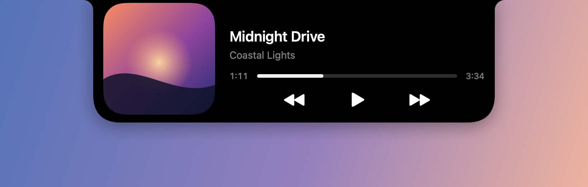
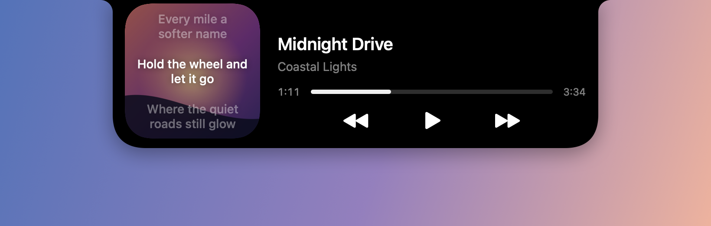

# SkyNotch

A player that lives in the MacBook notch.

| Playing | Volume | Charging |
| --- | --- | --- |
|  |  |  |

- Shows whatever is playing, from any app: music apps, a browser tab, anything that reports to the system.
- Swipe down with two fingers to open the card, swipe up to close it.
- Click the cover to flip it to time-synced lyrics.
- Volume, brightness, charging and headphones appear in the notch instead of a panel in the middle of the screen.
- Updates itself.

## Download

Get the disk image from the [latest release](https://github.com/Mhitaryan-Tigran/skynotch/releases/latest) and drag SkyNotch to Applications.

Requires macOS 14 or later on a MacBook with a notch.

## Permissions

Both are optional; without one, only its feature is off.

- **Accessibility** lets SkyNotch take the volume and brightness keys, so the system panel stays hidden.
- **Screen Recording** lets the sound wave follow the actual audio.
