<h1 align="center">SkyNotch</h1>

The MacBook notch, finally put to work. Now playing, your next meeting, volume, brightness and notifications, right where your eyes already are.

  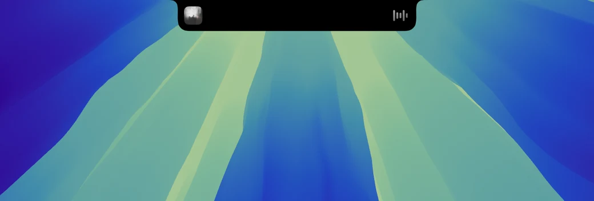

<a href="https://github.com/Mhitaryan-Tigran/skynotch/releases/download/v1.0.0-beta.1/SkyNotch-1.0.0-beta.1.dmg"><b>Download the free beta</b></a>

## Now Playing

<table>
<tr>
<td align="center" width="33%">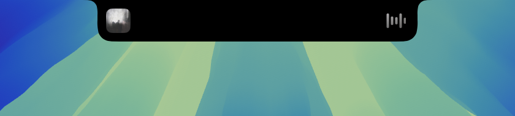 <b>Live</b> artwork and a waveform that follows the music</td>
<td align="center" width="33%">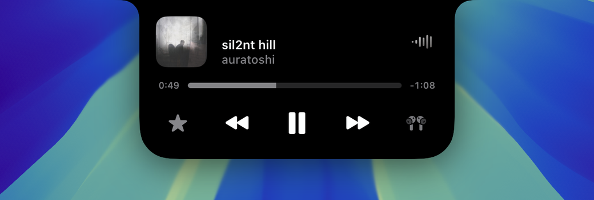 <b>Player</b> scrub, skip, like and pick the output</td>
<td align="center" width="33%">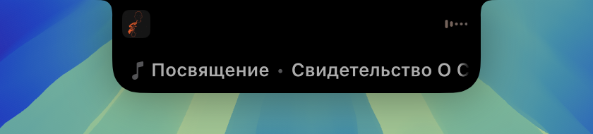 <b>Peek</b> the new title drops in when the track changes</td>
</tr>
</table>

Apple Music, Spotify and any app that reports what is playing, browsers included.

## Calendar

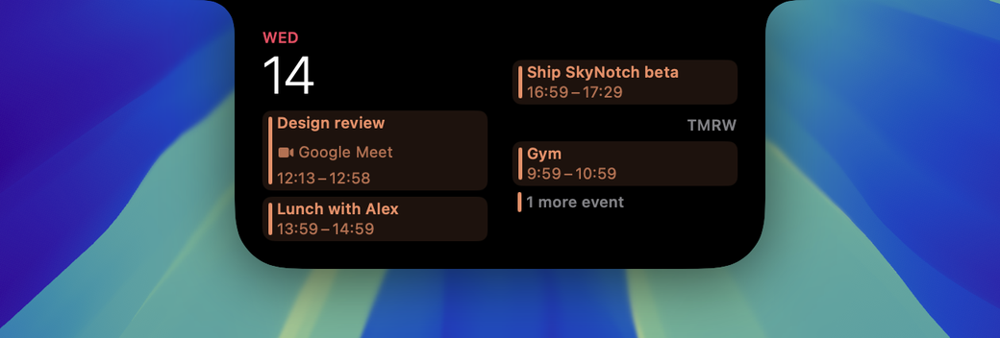

A countdown to your next event sits in the notch. Open it for today and tomorrow, join Zoom, Google Meet, Teams, FaceTime or Webex in one click, and get told when it is time to leave. Empty days show the weather.

## Volume and brightness

<table>
<tr>
<td align="center" width="50%"> <b>Volume</b> with the device you are listening on</td>
<td align="center" width="50%">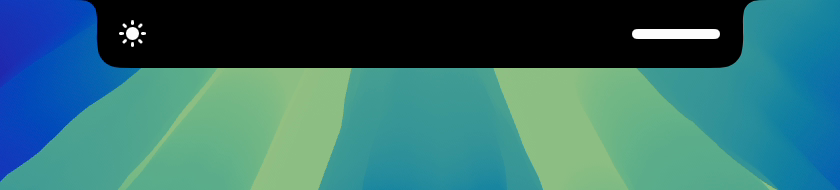 <b>Brightness</b> for the built-in and external displays</td>
</tr>
</table>

The system bezels are replaced by the notch, in white, accent or glow, with or without a label.

## Notifications

| Event | In the notch |
|---|---|
| AirPods | connected, with their battery, and a warning when it runs low |
| Battery | charging, low battery and Low Power Mode |
| Focus | the mode you just switched to |
| Lock screen | battery, connectivity, focus, calendar, weather and a now-playing player |

## Gestures

| Gesture | Does |
|---|---|
| Hover | lifts the notch; over the artwork it shows the title |
| Swipe down | opens the notch |
| Swipe up | dismisses the current activity |
| Swipe left or right | next or previous track, in the direction your trackpad scrolls |

## Settings

<table>
<tr>
<td align="center" width="33%">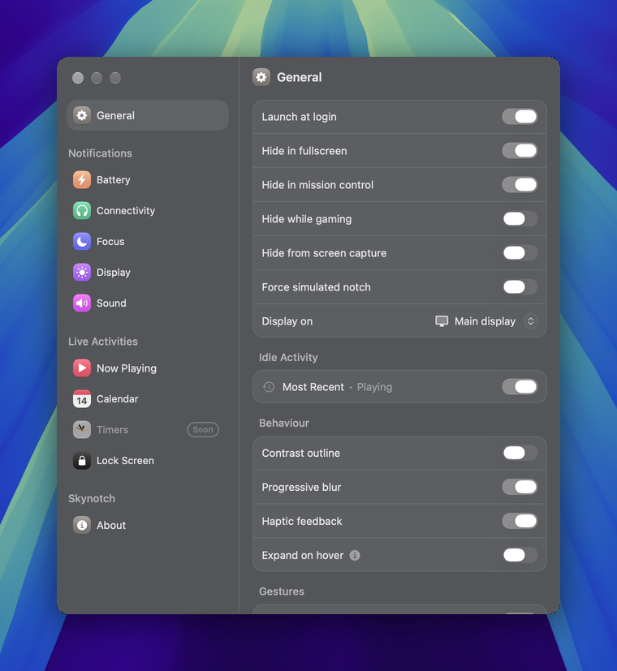 General</td>
<td align="center" width="33%">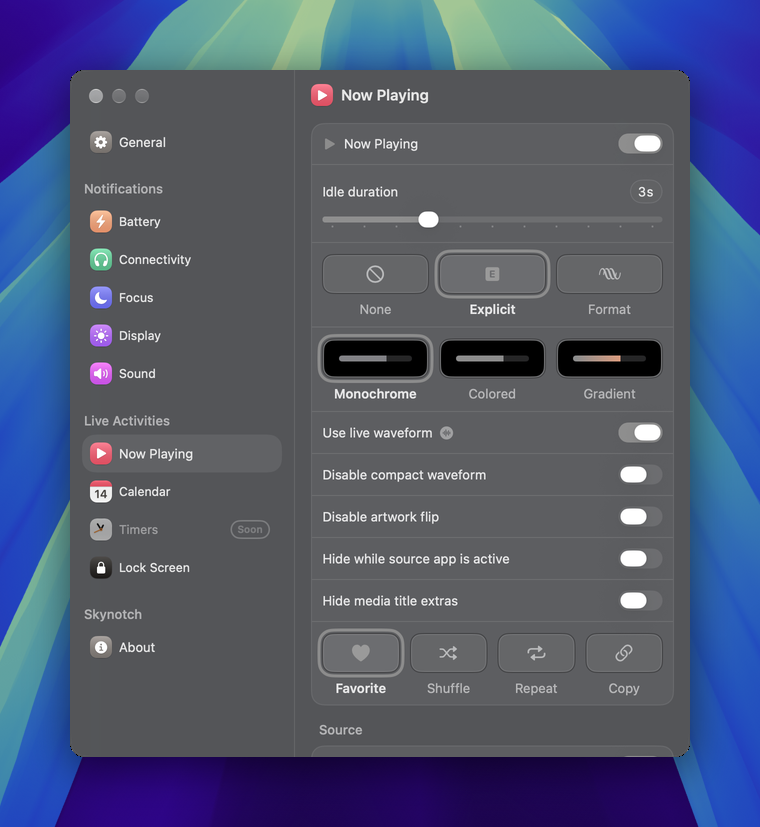 Now Playing</td>
<td align="center" width="33%">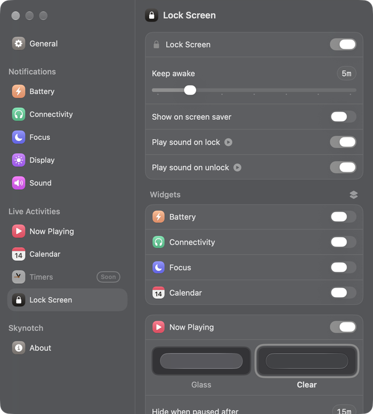 Lock Screen</td>
</tr>
<tr>
<td align="center" width="33%">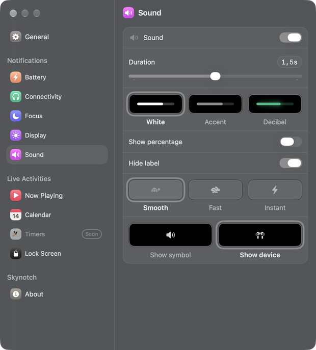 Sound</td>
<td align="center" width="33%">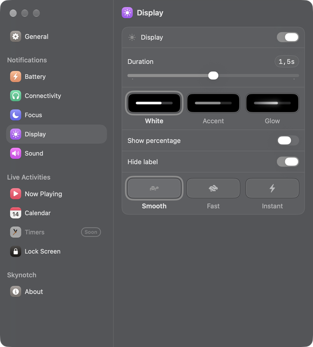 Display</td>
<td align="center" width="33%">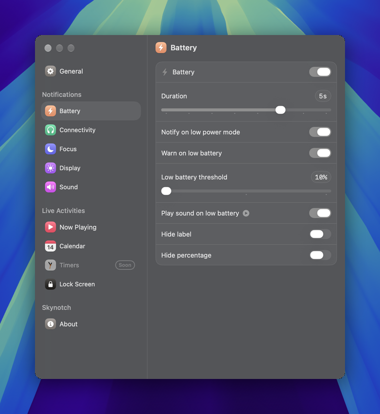 Battery</td>
</tr>
</table>

Hide it in fullscreen, while gaming, in Mission Control or from screen recordings, pick the display, tune haptics and the size of the notch.

## Install

1. Download the [disk image](https://github.com/Mhitaryan-Tigran/skynotch/releases/download/v1.0.0-beta.1/SkyNotch-1.0.0-beta.1.dmg) and drag SkyNotch to Applications.
2. Open it and follow the short setup. Each permission is asked only for the feature that needs it: Accessibility for the volume and brightness keys, audio capture for the waveform, Calendar, Location for the weather, Bluetooth for AirPods battery.
3. SkyNotch updates itself.

Free during the beta. No account, no analytics. Feedback: [support@skynotch.app](mailto:support@skynotch.app) or an [issue](https://github.com/Mhitaryan-Tigran/skynotch/issues).
